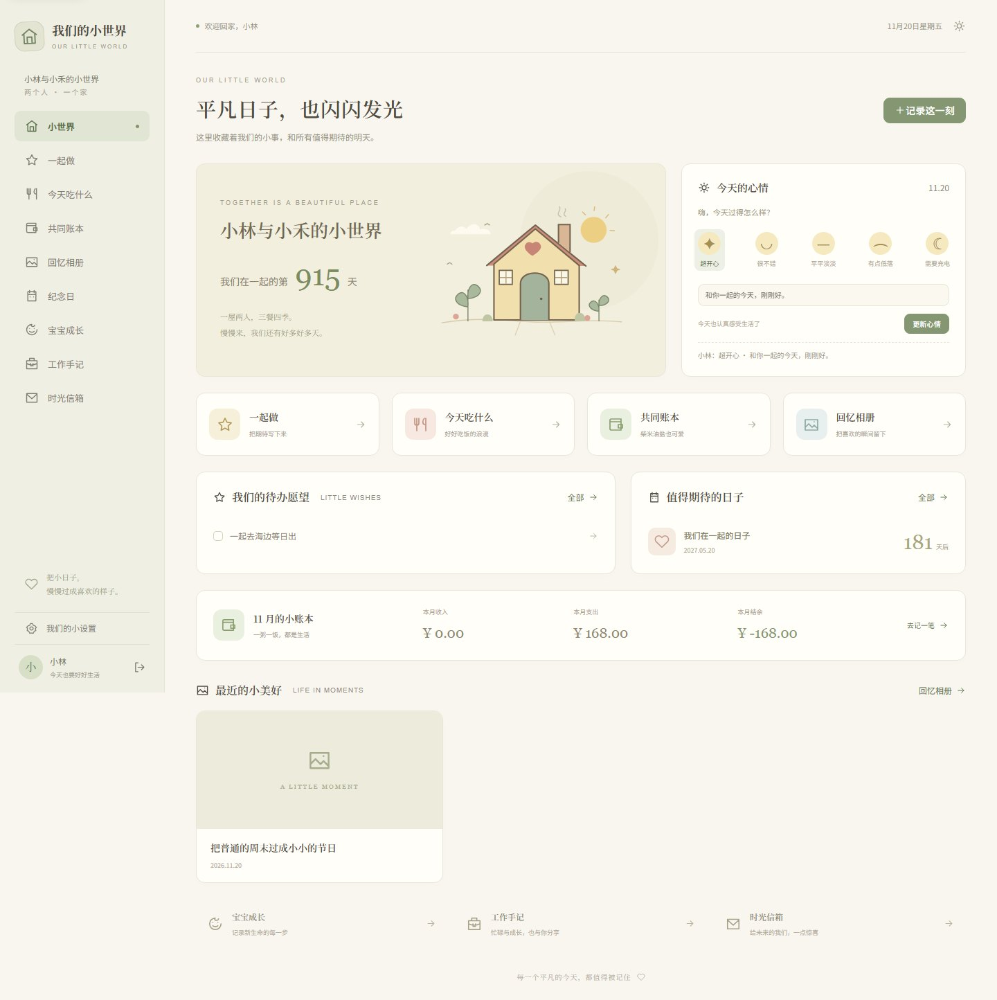
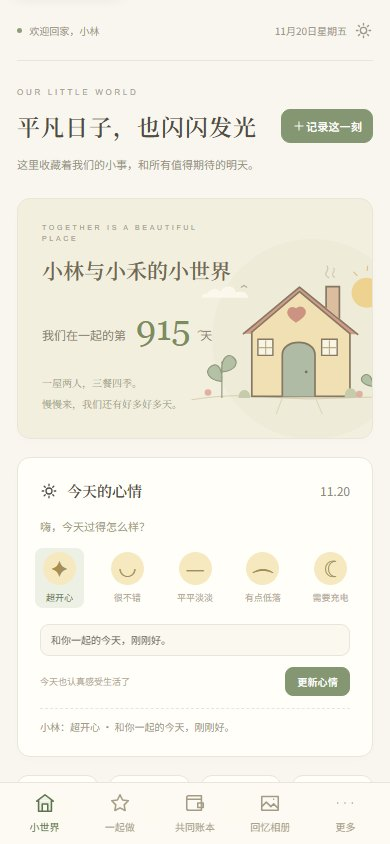
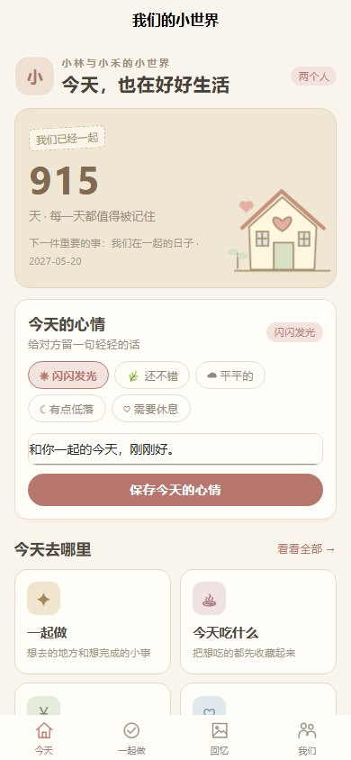
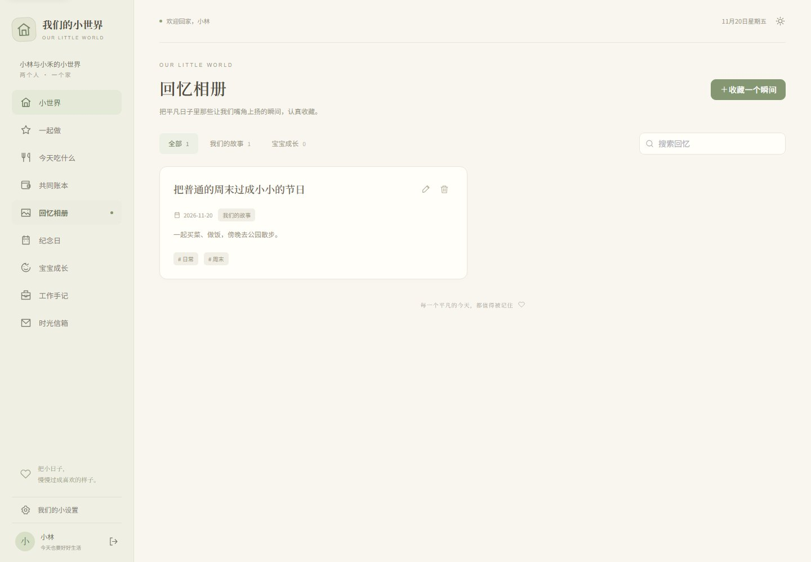
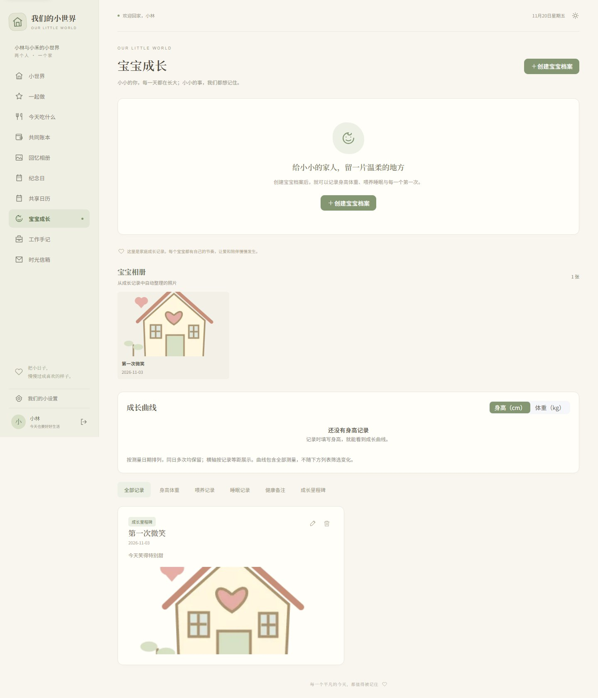
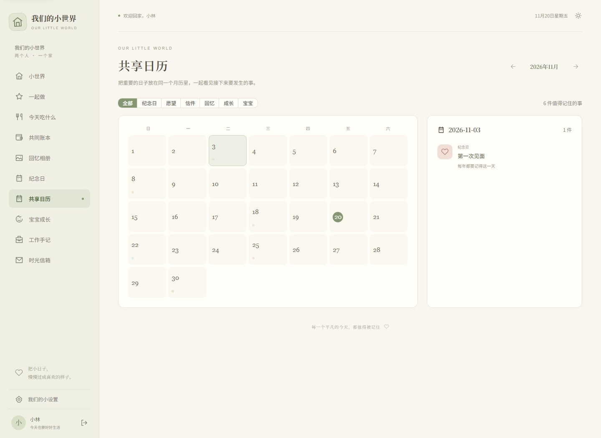
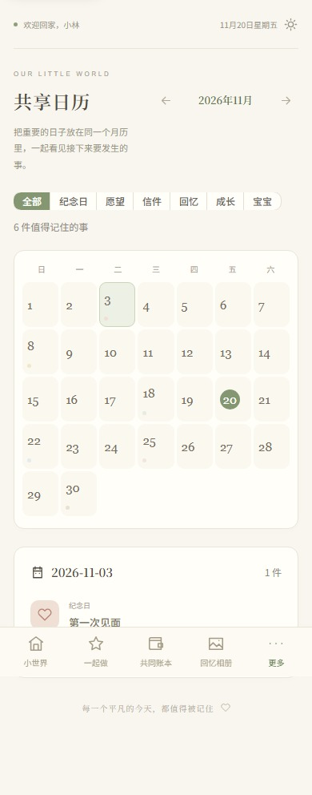
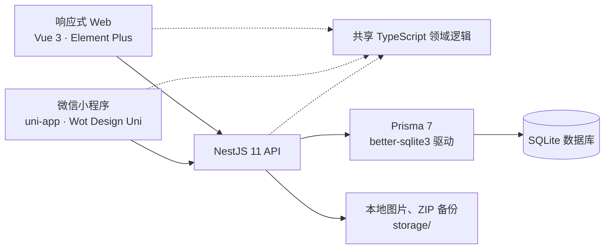

# 我们的小世界

> 把两个人的愿望、回忆和日常，收进一个由自己掌握的小家。

「我们的小世界」是一款面向伴侣的私人生活记录工具。它提供响应式 Web、微信小程序和统一的本地服务端；电脑浏览器、手机浏览器与小程序共用账号、API 和 SQLite 数据。界面以奶油色、手账卡片和暖色插画呈现，服务可以部署在自己的电脑、NAS 或常开小主机上。

## 界面预览

以下截图来自隔离的本地演示数据，不含真实用户资料。小程序图展示的是 uni-app H5 联调页面，用于预览与微信小程序共享的页面代码；正式微信运行仍需在开发者工具或真机中验收。

<p align="center">
  
</p>
<p align="center"><sub>桌面 Web：一起生活的每日概览与各功能入口</sub></p>

<p align="center">
  
  
</p>
<p align="center"><sub>左：手机 Web 首页；右：小程序 H5 联调首页</sub></p>

<p align="center">
  
</p>
<p align="center"><sub>Web 回忆相册：浏览故事、分类和标签</sub></p>

<p align="center">
  
</p>
<p align="center"><sub>Web 宝宝成长：成长记录照片自动整理为宝宝相册，并与身高体重曲线放在同一页</sub></p>

<p align="center">
  
</p>
<p align="center"><sub>桌面 Web：共享日历按月汇总重要日期，并显示选中日期的安排</sub></p>

<p align="center">
  
</p>
<p align="center"><sub>手机 Web：日历网格与日期详情适配窄屏，可上下滚动查看</sub></p>

## 项目概览

- **一起记录：** 心情、共同愿望、吃饭点单、账本、纪念日、共享日历、回忆相册、成长记录、工作手记和时光信箱。
- **双端共用：** Web 与微信小程序使用同一套 NestJS API 和 SQLite 数据；Web 桌面与手机浏览器使用同一套响应式页面。
- **自己掌握：** 数据库、图片附件和备份放在自己的服务端目录或 Docker 数据卷，不依赖外部 SaaS 数据库。
- **面向两个人：** 首位成员创建空间，第二位成员通过一次性邀请码加入；空间最多两位成员。
- **私密优先：** 空间资源按成员关系隔离，未解锁的时光信由服务端隐藏；照片会去除元数据并缩放、转换为 WebP，图片访问链接仅短时有效且响应禁止缓存，过期后 Web 与小程序会按需续签。

当前仅交付 Web、微信小程序和移动端适配网页，不包含 Android 或 iOS 原生应用。项目不提供即时聊天、实时定位、公开社区或第三方 AI 服务。

## 功能

| 模块       | 主要操作                                                                               |
| ---------- | -------------------------------------------------------------------------------------- |
| 双人空间   | 首次建号、登录、邀请码加入、双人上限、个人资料与密码                                   |
| 首页       | 在一起天数、今日心情、待办愿望、回忆、纪念日、当月账本                                 |
| 一起做     | 愿望增删改查、分类、完成与重开、目标日期                                               |
| 今天吃什么 | 菜品/饮品/餐厅、收藏、搜索、购物篮、下单与完成                                         |
| 共同账本   | 收支记录、付款人、分类、月份筛选与统计                                                 |
| 纪念日     | 自定义日期、每年重复、倒数，闰日按非闰年 2 月 28 日计算                                |
| 共享日历   | 切换月份、按类型筛选，查看纪念日、愿望、信件、回忆、成长记录与宝宝生日，并打开对应记录；来源已删除时保留提示并可返回全部 |
| 回忆相册   | 文字、多图、日期、标签与图片预览                                                       |
| 宝宝成长   | 可选档案、身高体重曲线、喂养、睡眠、健康备注、里程碑；成长记录照片自动汇集为宝宝相册；从日历打开的成长记录若已删除，会保留提示并恢复普通成长列表 |
| 工作手记   | 按日期、标签整理文字和图片                                                             |
| 时光信箱   | 写信、未来日期解锁，服务端隐藏未解锁内容                                               |
| 设置       | 空间信息、主题、邀请、接口地址、资料、导出与备份恢复；主题按钮向辅助技术暴露选中状态       |

这是家庭记录工具，健康内容仅用于个人记录。聊天、实时定位、公开社区和第三方 AI 服务不在当前范围内。

### 宝宝相册

宝宝相册不需要单独维护：在成长记录中上传的照片会自动进入相册，按成长记录日期倒序排列；同一附件只展示一次，照片会保留来源记录的标题和日期。点击缩略图可以预览原图，暂时没有照片时会显示引导，提示从成长记录开始添加。相册与宝宝档案、成长曲线共用同一页面，适合在电脑或手机浏览器中快速回看。

小程序首次读取失败时会提示重新加载，不会把已有记录误显示成空列表或零统计；刷新失败会保留上次读到的内容，菜单与点单历史可独立重试。
Web 中的单行表单可直接按 Enter 保存，多行文本仍可正常换行；微信小程序将短提示显示为轻提示，较长错误会以完整弹窗展示。

## 本地启动

需要 Node.js **22.12 或更新版本**（推荐仍受支持的 LTS 版本）和 npm 10+。在仓库根目录运行：

```sh
npm ci
npm run init
npm run build:api
npm run build:web
npm start
```

浏览器打开 `http://localhost:3000`。第一次创建空间前，在服务端运行目录读取 `storage/.setup-token`（PowerShell：`Get-Content .\storage\.setup-token`；Docker：`docker compose exec world cat /app/storage/.setup-token`），并填写页面要求的一次性验证码及自己的用户名、密码、昵称、空间名与在一起日期。验证码只保存在服务端；空间创建成功后自动删除。项目没有预设账号或通用密码。创建后，在设置中生成邀请码给另一半；第二个人通过加入入口注册自己的账号。邀请码有时效且只能使用一次。

`npm run init` 创建根 `.env`、生成私密附件签名密钥、创建数据目录、生成 Prisma Client，并应用仓库内的数据库迁移。API 首次启动时会在 `storage/.setup-token` 创建权限受限的一次性验证码；重复运行不会清空数据或覆盖已设置的密钥。可用环境变量 `SETUP_TOKEN` 自行指定至少 32 字节且不超过 256 个字符的验证码。

默认限流窗口为 60 秒，每个客户端的登录、初始化和加入请求上限为 20 次，普通 API 请求上限为 600 次。可在根 `.env` 中调整 `AUTH_RATE_LIMIT`、`GENERAL_RATE_LIMIT` 和 `RATE_LIMIT_WINDOW_MS`；生产环境建议保留默认值或按实际流量谨慎调整。

Windows 可以直接在 PowerShell 运行：

```powershell
powershell -ExecutionPolicy Bypass -File .\scripts\start-local.ps1
```

脚本在当前窗口安装依赖、初始化、构建并启动；按 `Ctrl+C` 停止。它不弹出额外后台窗口。已装过依赖时可加 `-SkipInstall`，开发模式加 `-Dev`。

开发时运行：

```sh
npm run init
npm run dev
```

Web 默认 `http://localhost:5173`，API 默认 `http://localhost:3000/api`。开发启动器同时运行两个服务，`Ctrl+C` 一起停止。

在手机浏览器中直接打开同一个 Web 地址即可使用；支持 PWA 的浏览器会提供“添加到主屏幕”入口，安装后使用独立窗口和离线外壳。iPhone/iPad 请在 Safari 的分享菜单中选择“添加到主屏幕”，Android/桌面 Chrome 通常会在地址栏或菜单中显示安装入口。离线外壳只缓存页面代码，不缓存私人记录、登录会话或图片；断网时页面会明确提示需要恢复连接。

## 项目目录与技术

```text
apps/api          NestJS 11 / TypeScript / Prisma 7 / SQLite
apps/web          Vue 3 / TypeScript / Vite / Element Plus / Tailwind / Pinia / ECharts
apps/uni          Vue 3 / TypeScript / Vite / uni-app / Wot Design Uni / Tailwind
packages/shared   日期、金额与共享领域逻辑
scripts           初始化、并行开发、生产启动与运行检查
data              本机 SQLite 数据（不提交）
storage           本机附件与备份（不提交）
```

### 架构与数据流



Web 和微信小程序通过同一套 API 读写双人空间。服务端负责登录会话、空间成员校验、照片处理和备份；SQLite 保存结构化记录，`storage/` 保存处理后的照片与备份。响应式 Web 可直接在手机浏览器访问，不需要安装 Android 或 iOS 应用。

### 文档维护约定

每次新增、调整或移除用户可见功能，以及改变安装、配置、部署、数据保存或备份行为时，都要在同一项改动中更新本 README 的功能、操作或部署说明。界面明显变化时同步更新对应截图；API 路由或响应变化时同步维护 `docs/API-CONTRACT.md`；产品范围、部署方式和验收结果有变化时，也要更新 `docs/PRODUCT.md`、`docs/DEPLOYMENT.md` 和 `docs/VERIFICATION.md` 中受影响的部分。只有内部实现变化时，也要检查技术栈、目录和架构说明是否仍准确。

根 `.env` 的相对路径统一从仓库根目录解释；使用根脚本启动。只运行 `apps/api` 内部命令时需要自行配置该目录的环境，不能把两个位置的相对路径混用。

## 构建与验证

```sh
npm test
npm run typecheck
npm run test:e2e
npm run test:e2e:uni
npm run test:e2e:unit
npm run test:e2e:cleanup
npm run test:shared
npm run test:scripts
npm run test --workspace=@our-little-world/api
npm run test --workspace=@our-little-world/web
npm run test --workspace=@our-little-world/uni
npm run build:api
npm run build:web
npm run build:uni:h5
npm run build:mp-weixin
npm run health
node --experimental-strip-types scripts/verify-demo.mts
```

两套浏览器验证都会自动启动服务并使用临时数据库与附件目录，结束后停止本次服务并删除临时数据。主 Web 使用端口 `3001`、`5174`；小程序 H5 联调使用 `3002`、`5175`，端口已占用时拒绝启动，不复用已运行的服务。`test:e2e:cleanup` 单独验证两套环境的进程停止和临时目录清理；`test:e2e:unit` 不启动服务，以内存替身验证退出迟缓、终止失败和安全重试。收尾无法确认本次进程关闭时会报错并保留临时数据，不会继续删除。

微信官方模拟器的可选验收命令为 `npm run test:wechat`，加 `-- --media` 验证图片上传/下载和 ZIP 恢复。它使用独立项目副本、临时数据库与随机 API 端口，SDK 另行安装；安装、端口配置、受控选择器边界及清理说明见 [微信模拟器验收](docs/WECHAT-VERIFICATION.md)。

如果 Web 测试的 `5174` 已被其他程序使用，可在 PowerShell 先设 `$env:WEB_E2E_BASE='http://127.0.0.1:5184'`，再运行 Web 或清理测试。页面、隔离服务和清理检查会统一使用该端口；只接受本机 HTTP 地址，API 仍使用 `3001`。

Web 产物在 `apps/web/dist`；微信小程序产物在 `apps/uni/dist/build/mp-weixin`。`apps/uni/dist/build/h5` 保留用于小程序页面的浏览器联调。Web 构建由 Nest 服务提供，生产访问只需要一个 `3000` 端口。

演示数据仅由 `npm run demo` 显式生成。它只接受没有空间的数据库，不会覆盖现有账号；运行后保存终端中随机生成的临时密码。实际使用请在空数据库的首次运行页创建自己的空间。不要把带真实数据的 SQLite、照片、`.env` 或备份提交到 Git。

`scripts/verify-demo.mts` 在临时数据库和附件目录中验证首次生成及再次运行拒绝覆盖，结束后清理临时数据，不改动本机实际空间。

## 局域网与双端

同一 Wi-Fi 下，电脑保持运行，手机访问 `http://电脑局域网IP:3000`。例如电脑 IP 为 `192.168.1.50`，地址就是 `http://192.168.1.50:3000`。在 Windows 防火墙中仅为需要的私人网络允许 TCP `3000`。手机上的 `localhost` 指手机自身。

微信小程序的设置页可以填写 API 地址，开发期例如 `http://192.168.1.50:3000/api`。Web 使用同源 `/api`，手机浏览器直接访问同一站点。电脑关机、睡眠、切换网络或 IP 变化后，其他设备会暂时无法连接。

微信小程序需要自己的 AppID，在 `apps/uni/src/manifest.json` 和微信开发者工具中配置。将 `mp-weixin` 构建目录导入开发者工具后调试。开发者工具的“不校验合法域名”只用于开发；正式真机/发布需要在微信后台配置符合要求的 HTTPS 请求、上传和下载域名，并完成自己的主体、域名及发布流程。仅本地端口不能作为远程发布入口。

## Docker

需要 Docker Engine 或 Docker Desktop，并启用 Compose。首次生成本机配置，然后构建启动：

```sh
node --experimental-strip-types scripts/init.mts --config-only
docker compose up -d --build
docker compose logs -f world
```

访问 `http://localhost:3000`。第一次创建空间前，读取容器中的一次性验证码：`docker compose exec world cat /app/storage/.setup-token`。创建成功后该文件会自动删除。容器启动时应用数据库迁移，数据库和附件分别保存在 `world-data`、`world-storage` 命名卷。`.env` 中的 `ASSET_SECRET` 由 Compose 传入容器。停机可用 `docker compose down`；**不要加 `-v`，否则会删除数据卷**。

容器与直接 Node 运行默认使用不同数据位置；切换部署方式需保留原账号身份，按部署说明中的离线迁移步骤操作。2026-11-17 的镜像构建、Compose 启动、健康检查、重启后记录与照片持久化，以及 ZIP 备份恢复均在本次 Prisma 7 迁移前验证；本轮 Docker 引擎未运行，因此尚未复验迁移后的 Docker 镜像与 Compose，详见 `docs/VERIFICATION.md`。

## 数据与备份

设置里的 **JSON 导出**用于可读的数据携带，不包含登录密码、会话和图片文件；完整迁移应使用 **ZIP 备份**，同时保存数据库和附件。ZIP 中的 `data.json` 和 `database.sqlite` 来自同一数据库快照，避免并发写入时两种恢复数据不一致。恢复前先下载一次当前 ZIP，使用空间所有者账号操作。恢复会替换当前空间记录，保留当前账号与密码；成功后刷新即可，不需要重启服务。

如果当前磁盘上的照片已经丢失，仍可用先前保存的完整 ZIP 恢复。恢复前保护副本会保存现有记录和可读取的照片，并在 `manifest.json` 的 `missingAssets` 中标记缺失文件；界面也会显示提示。这种标记为 `complete: false` 的保护副本用于追溯现状，不能作为完整 ZIP 直接恢复。普通下载和自动备份遇到缺失照片会报错，不会生成看似完整的备份。

网页 ZIP 下载和恢复使用同一容量范围：最多 10000 条生活记录、10000 个 ZIP 内文件（其中 3 个为固定文件）、展开后合计 250MiB、ZIP 文件 100MiB。超出范围会明确拒绝，并提示停止服务后复制 `data`、`storage` 与 `.env` 做离线备份。当前数据超限时恢复也会在覆盖前停止，以免无法留下保护副本。文件大小异常的照片会在保护副本的 `damagedAssets` 中标记并保留现有字节，仍能用以前完整 ZIP 修复。

服务默认每 24 小时在 `storage/backups` 自动保存一次 ZIP，保留最新 7 份自动备份；恢复前的保护副本也独立保留最新 7 份。根 `.env` 的 `AUTO_BACKUP_HOURS=24` 可调整间隔，正数范围为 1–596 小时，`0` 关闭。首次自动备份需服务连续运行一个完整间隔；请定期将备份复制到另一块磁盘。

上传图片会去除元数据、限制尺寸并转为 WebP。备份保存的是服务内的图片版本；需要保留相机原片时，请另行保存。ZIP 中包含可用于离线恢复的数据库，因此也包含账号密码哈希，应作为私人文件保管。

`.env` 中持久密钥也应私下备份。最稳妥的离线保全方式是先停止服务，再一起复制 `data`、`storage` 与 `.env`。SQLite 启动时可能有 `-wal`/`-shm` 文件，运行中不要只复制主 `.db`。至少做一次真实恢复检查，确认照片和记录能打开。

完整的路径、HTTPS、升级、恢复和故障处理见 [部署说明](docs/DEPLOYMENT.md)。
